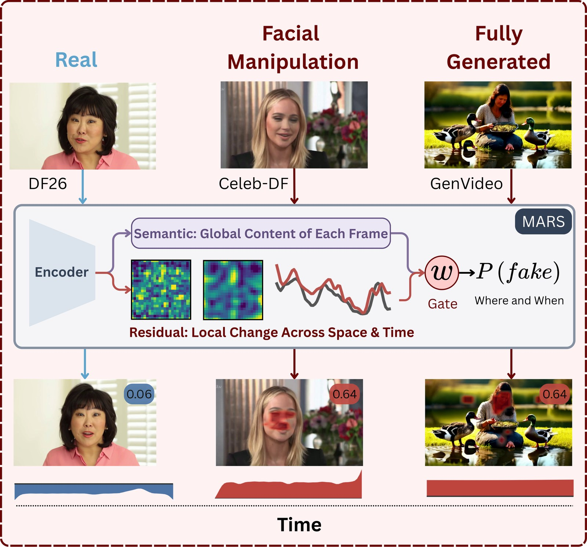
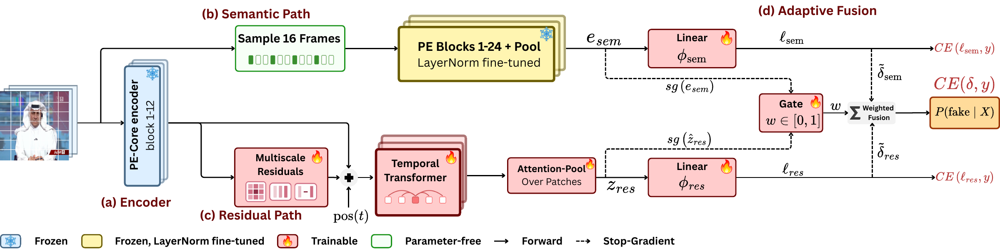
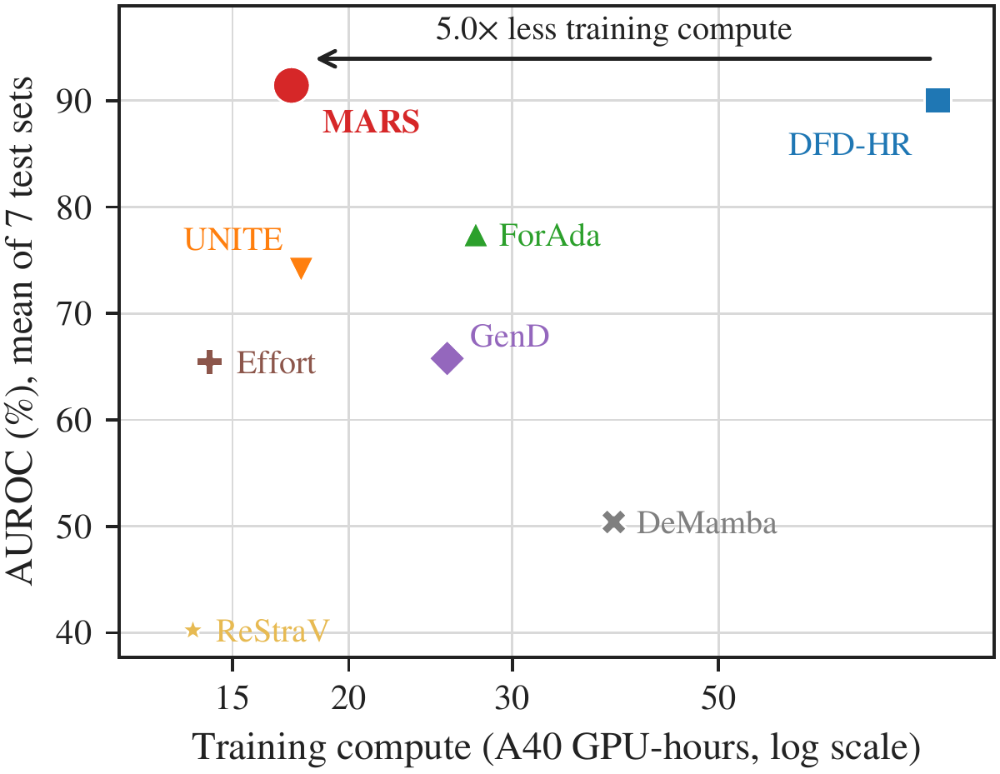

# MARS: Multiscale Appearance-Residual Streams for Video Forgery Detection

[](https://github.com/VectorInstitute/mars/actions/workflows/code_checks.yml)
[](https://github.com/VectorInstitute/mars/actions/workflows/unit_tests.yml)
[](https://github.com/VectorInstitute/mars/actions/workflows/integration_tests.yml)
[](https://arxiv.org/abs/XXXX.XXXXX)
[](https://vectorinstitute.github.io/mars)
[](https://www.python.org/)
[](https://github.com/astral-sh/uv)
[](https://github.com/astral-sh/ruff)
[](mailto:shaina.raza@vectorinstitute.ai)

Project page: <https://vectorinstitute.github.io/mars>



*One detector for facial manipulation and generated video. MARS reads each clip with a residual path
(local changes across space and time) and a semantic path (global content of each frame), mixed by a
gate, and returns P(fake) with the patches and frames that drove it.*

## What this is

MARS is a full-frame video forgery detector that covers both facial manipulation (face
swapping, reenactment) and fully generated video. It reads one frozen Perception Encoder
(PE-Core-L) in two complementary ways:

1. A **residual path** compares the encoder's intermediate patch features with smoothed
   copies of themselves, across space and across time, at several scales, and a temporal
   transformer models how these differences develop over the clip.
2. A **semantic path** classifies sampled frames with the complete encoder, tuning only its
   own copies of the LayerNorm parameters.

A gate mixes the two paths per clip. Because the final score is a sum of patch and frame
terms, MARS also returns signed patch and frame contributions for every prediction, without
a separate explanation model.

This repository contains MARS, the seven detectors we compare against (DFD-HR, GenD, ForAda,
UNITE, Effort, DeMamba, ReStraV), re-implemented under one shared protocol, and every script
behind the paper's tables and figures.

**What this is not.** The baselines are re-implementations of each method's network and
training objective inside our pipeline. Inputs, optimization, checkpoint selection and
evaluation follow the shared protocol below, not each paper's original setup, so numbers can
differ from those reported by the original authors.

## Architecture



*(a) A frozen PE-Core-L encoder is split after block 12. (b) The semantic path runs 16 sampled
frames through all 24 blocks with its own trainable LayerNorm parameters. (c) The residual path
turns the block-12 features of all 64 frames into multiscale spatial and temporal
difference-of-Gaussians streams, models them with a temporal transformer and pools over
patches. (d) A gate, fed with stop-gradient features, mixes the standardized margins of the two
paths.*

- **Inputs:** clips of 64 frames, every second frame of the video, full frames at 336 x 336.
- **Encoder:** `vit_pe_core_large_patch14_336.fb` (timm), frozen.
- **Training:** cross-entropy on each path and on the fused prediction; the fused loss trains
  only the gate.
- **Evidence:** `src/mars/models/mars/attribution.py` splits the fused margin exactly into
  frame scores and per-frame patch maps.

## Results



Trained on FF++ and GTA-V and averaged over seven test sets, MARS reaches 91.43% video AUROC,
against 90.03% for the strongest baseline (DFD-HR), with 17.4 instead of 86.1 A40 GPU-hours of
training. The paper reports per-dataset and per-generator results, seeds, training length,
clip length, ablations, robustness to common degradations, and the faithfulness of the
evidence maps.

- **Across seeds:** 90.69 +- 1.02 average AUROC over five training seeds, the highest of the eight
  detectors.
- **Transfer without generated training data:** trained on FF++ alone, MARS reaches 93.99% AUROC on
  GenVideo and 75.50% on DF26.

## Quick start

From a fresh clone to a trained and evaluated MARS:

```bash
# 0. Install
git clone https://github.com/VectorInstitute/mars.git && cd mars && uv sync

# 1. Place the corpora under data/ (or edit root: in configs/datasets/*.yaml),
#    then build each manifest once
uv run python -m mars.data.ffpp --config configs/datasets/ffpp.yaml
uv run python -m mars.data.gtav --config configs/datasets/gtav.yaml
#    ...and likewise celebdf, dftimit, uadfv, hififace (hififace_paired.yaml), genvideo, df26

# 2. Train MARS; when training ends, every set in data.test is scored automatically
sbatch scripts/train.sh --config configs/models/mars/config.yaml
#    -> checkpoints/mars/mars_s0/best.pt and results/mars/mars_s0/<corpus>/

# 3. (Optional) Evaluate the checkpoint again later, on every test set or on one
sbatch scripts/eval.sh --config configs/models/mars/config.yaml \
  --checkpoint checkpoints/mars/mars_s0/best.pt --dataset df26
```

Each step is detailed in the sections below. Without a Weights & Biases login, training logs to CSV only.

## Installation

MARS uses [uv](https://docs.astral.sh/uv/) and Python 3.12.

```bash
git clone https://github.com/VectorInstitute/mars.git
cd mars
uv sync
cp .env.example .env    # optional: FFMPEG_SHARED for video decoding
```

Training and evaluation need CUDA GPUs; the paper uses four NVIDIA A40s per run. The unit
tests run on CPU.

## Data

Every corpus has a YAML file in `configs/datasets/` with its root folder, its roles (train,
val, test) and its manifest path. Roots default to `data/<name>`; download each corpus from its
official release, place or symlink it there (or edit `root:`), then build its manifest once:

```bash
uv run python -m mars.data.ffpp     --config configs/datasets/ffpp.yaml
uv run python -m mars.data.gtav     --config configs/datasets/gtav.yaml
uv run python -m mars.data.celebdf  --config configs/datasets/celebdf.yaml
uv run python -m mars.data.dftimit  --config configs/datasets/dftimit.yaml
uv run python -m mars.data.uadfv    --config configs/datasets/uadfv.yaml
uv run python -m mars.data.hififace --config configs/datasets/hififace_paired.yaml
uv run python -m mars.data.genvideo --config configs/datasets/genvideo.yaml
uv run python -m mars.data.df26     --config configs/datasets/df26.yaml
```

| Corpus | Use | Default root | Notes |
|---|---|---|---|
| FaceForensics++ (c23) | train, val, test | `data/FF++/data` | official splits; Deepfakes, Face2Face, FaceSwap, NeuralTextures |
| GTA-V (SAIL-VOS 3D) | train | `data/sailvos3d` | rendered sequences, all synthetic |
| Celeb-DF v2 | test | `data/Celeb-DF-V2` | official test list (518 videos) |
| DeepfakeTIMIT | test | `data/DeepfakeTIMIT` | 640 swaps paired with 320 VidTIMIT recordings |
| UADFV | test | `data/UADFV` | 49 authentic, 49 manipulated |
| HiFiFace (paired) | test | `data/HifiFace` | swaps whose target is in the FF++ test split, paired with that target |
| GenVideo | test | `data/GenVideo-Val` | validation split, 10 generators |
| DF26 | test | `data/DF26` | 10 generators |


## Training and evaluation

`scripts/train.sh` and `scripts/eval.sh` run with `bash` locally or with `sbatch` on Slurm.
A model YAML defines one experiment; `--set` overrides any dotted key.

```bash
# Train MARS (FF++ + GTA-V, 3 epochs, seed 0); the test battery runs after training
sbatch scripts/train.sh --config configs/models/mars/config.yaml

# Evaluate a checkpoint on every test set, or on one with --dataset
sbatch scripts/eval.sh --config configs/models/mars/config.yaml \
  --checkpoint checkpoints/mars/<group>/<run_name>/best.pt --dataset df26

# Train a baseline
sbatch scripts/train.sh --config configs/models/dfd_hr/config.yaml

# Faithfulness tests of the MARS evidence (splice, deletion, temporal)
sbatch scripts/faithfulness.sh --config configs/models/mars/config.yaml \
  --checkpoint checkpoints/mars/main_ffpp_gtav/mars_s0/best.pt --test splice
```

Checkpoints are written to `checkpoints/<model>/<group>/<run_name>/` and metrics to
`results/<model>/<group>/<run_name>/<corpus>/`, with a `summary.md` per run.

## Reproducing the paper

Each script in `experiments/` submits the runs of one group; `DRY_RUN=1` prints the commands
instead of submitting them. See [experiments/README.md](experiments/README.md).

| Paper result | Script |
|---|---|
| Cross-dataset comparison, FF++ + GTA-V | `experiments/main.sh` |
| Cross-dataset comparison, FF++ only | `experiments/ffpp_only.sh` |
| Seeds 0, 5, 10, 15, 20 | `experiments/seeds.sh` (`SEEDS="15 20"` for the last two) |
| Frames per clip (8, 16, 32) | `experiments/frames.sh` |
| Training length (5, 10 epochs) | `experiments/epochs.sh` (also runs 20) |
| MARS ablations, split layer, backbone, semantic frames | `experiments/mars_design.sh` |
| Robustness (JPEG, blur, downscaling, noise) | `experiments/robustness.sh` |
| Faithfulness | `scripts/faithfulness.sh --test splice / deletion / temporal` |

## Evaluation protocol

All eight detectors are trained on the FF++ c23 and GTA-V training splits for three epochs
with AdamW (learning rate 1e-4, halved every 1,000 steps), an effective batch of 32 clips and
seed 0, on full frames without face cropping or augmentation. The checkpoint with the highest
video-level AUROC on the FF++ validation split is kept. A video's score is the mean of its clip
probabilities, and we report video-level AUROC, average precision and equal error rate.
Generated-video sets are also scored per generator against all authentic videos of the same
set. Energy, carbon and GPU-hours of every run are recorded with the ai-impact-accounting
package.

## Repository layout

```text
configs/        shared.yaml, datasets/<corpus>.yaml, models/<model>/config.yaml
experiments/    one script per paper experiment group
scripts/        train.sh, eval.sh, faithfulness.sh (bash or sbatch)
src/mars/
  models/       one self-contained package per detector (models/mars is MARS)
  data/         corpus loaders, manifests, clip sampling, perturbations
  train/        training loop and run config
  eval/         scoring, metrics, thresholds, faithfulness tests
  losses/       shared cross-entropy
  utils/        distributed setup, seeding, logging, compute accounting
tests/mars/     CPU unit tests
data/           dataset roots (you place or symlink the corpora here)
artifacts/      dataset manifests, written by the manifest commands
checkpoints/    best.pt and last.pt per run, written by training
results/        metrics, predictions and summary.md per run, written by evaluation
logs/           Slurm job logs
```

Adding a detector or a corpus is described in
[src/mars/models/README.md](src/mars/models/README.md) and
[src/mars/data/README.md](src/mars/data/README.md).

## Development

```bash
uv sync --all-extras --dev
pre-commit install
uv run pytest -m "not integration_test" tests
uv run ruff check . && uv run ruff format --check .
uv run mypy --config-file pyproject.toml src
```

## Troubleshooting

- **Videos fail to decode or decode slowly.** Frames are read with PyAV (`data.decode_backend: pyav`);
  install FFmpeg on the system if PyAV cannot open a codec, and check one file with `ffprobe`.
- **CUDA out of memory.** Lower `train.micro_batch_size` (gradient accumulation keeps the effective
  batch of 32), for example `--set train.micro_batch_size=4`.
- **A dataset is skipped or has no videos.** Check `root:` in `configs/datasets/<corpus>.yaml` and
  rebuild that corpus's manifest after moving the data.
- **`best.pt exists; pass --experiment <new-name>`.** Runs never overwrite each other; give the run a
  new name with `--experiment`.

## Support

Open a [GitHub issue](https://github.com/VectorInstitute/mars/issues) for bugs and questions. For
collaboration, contact [shaina.raza@vectorinstitute.ai](mailto:shaina.raza@vectorinstitute.ai).
Contributions are welcome; see [CONTRIBUTING.md](CONTRIBUTING.md).

## Citation

```bibtex
@article{radwan2026mars,
  title   = {MARS: Multiscale Appearance-Residual Streams for Video Forgery Detection},
  author  = {Radwan, Ahmed Y. and Raza, Shaina},
  journal = {arXiv preprint arXiv:XXXX.XXXXX},
  year    = {2026}
}
```

## Acknowledgments

Resources used in preparing this research were provided, in part, by the Province of Ontario, the
Government of Canada through CIFAR, and companies sponsoring the Vector Institute.

This research was funded by the European Union's Horizon Europe research and innovation programme
under the AIXPERT project (Grant Agreement No. 101214389).
